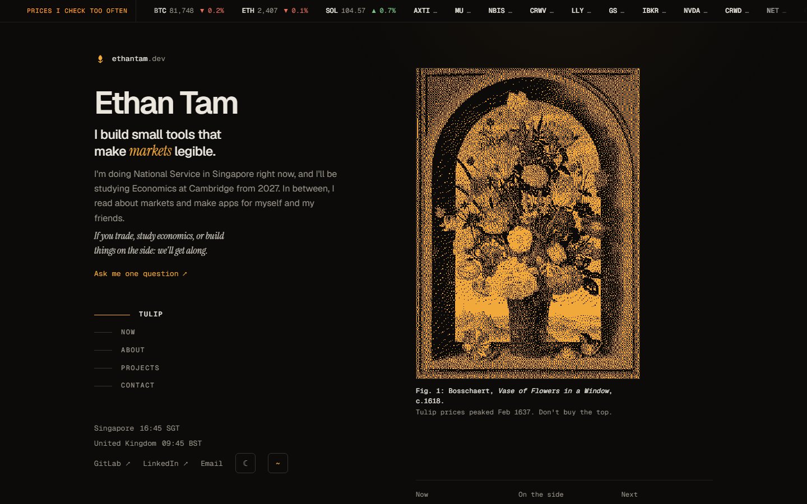
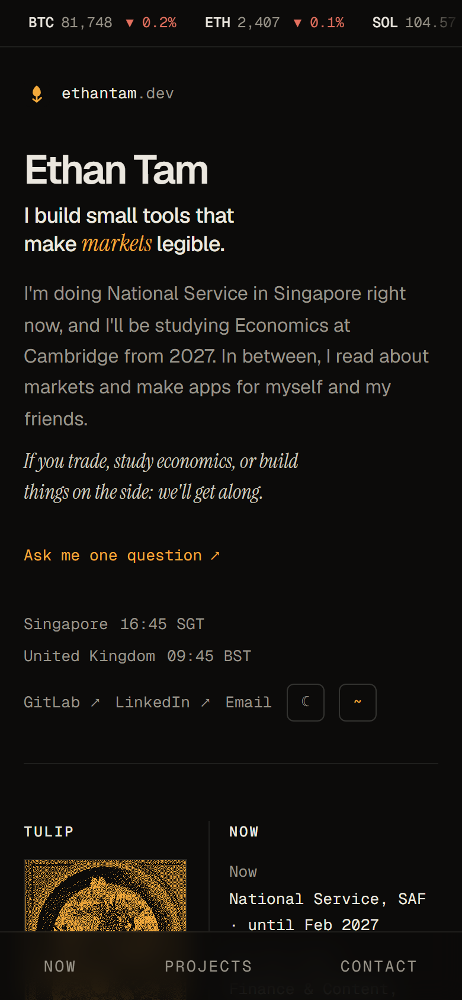
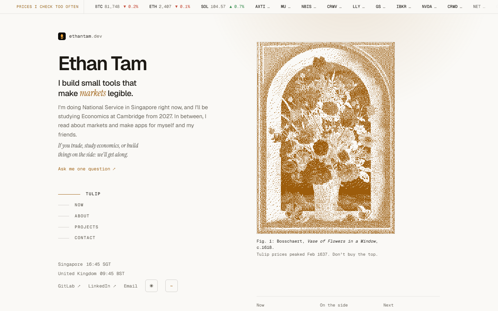

# ethantam.dev

Personal site of Ethan Tam: who I am, what I'm doing now, and the projects I've built, with a live ticker of the prices I check too often and a dithered tulip painting. Plain HTML, CSS and JavaScript: no build step, no dependencies.


<p align="center">
  
  
</p>
<p align="center">
  
</p>
<p align="center"><sub>Dark mode on desktop and phone, and light mode. Live prices.</sub></p>

## At a glance

| | |
| --- | --- |
| **Live** | https://ethantam.dev |
| **Hosting** | Cloudflare Worker `ethantam-dev` with static assets; every push to `main` deploys through GitLab CI (`.gitlab-ci.yml`) |
| **Data** | None stored. The ticker streams from the Worker's `/api/live` (Yahoo for stocks, Coinbase for crypto). |
| **Run locally** | `npm install && npm run dev` |
| **Source** | [gitlab.com/eatentam/ethantam.dev](https://gitlab.com/eatentam/ethantam.dev) (moved from GitHub on 17 Oct 2026) |

Settings: none on the site. The CI deploy needs a `CLOUDFLARE_API_TOKEN` CI/CD variable (masked and protected).

## Features

- **Ticker:** streaming prices for a watchlist of stocks and crypto, tick by tick. One Durable Object holds an upstream socket to Yahoo's streamer (stocks) and one to Coinbase's ticker (crypto), and pushes every change to each visitor over a WebSocket (`/api/live`), at most four times a second. Every visitor sees the same numbers. A price flashes green or red as it moves, and the dot by the label is lit while the stream is up. Outside 9:30-16:00 New York, stocks show the pre-market or after-hours price, tagged `PRE` or `AH`, with the change against the previous close. Crypto change is over the last 24 hours. If the socket can't connect, the page polls `/api/quotes` every 5s, and without the Worker at all it falls back to CoinGecko for crypto only. A hidden tab lets go of the socket after a minute and catches up the moment it's back. With nobody watching, the Durable Object closes its upstreams and sleeps.
- **Painting:** Ambrosius Bosschaert the Elder, *Vase of Flowers in a Window* (c.1618, Mauritshuis, public domain), dithered in the browser on a canvas. Hover or tap to see the original.
- **Layout:** on desktop the name and section nav stay pinned on the left while the rest scrolls on the right, and the nav marks the section you're reading (the layout follows Brittany Chiang's site). Phones and tablets get one column with sticky section titles.
- **Project cards:** each project with why it exists, what it grew into, and two screenshots: 780×1440 captures saved as WebP in `assets/`. Live data for Equarian Markets and Oracular; demo data for 20bucks, The List and Trade Journal; test data for Tally.
- **Terminal:** press `~` anywhere (or the `~` button) and type `help`.
- **Themes:** dark and light mode with a toggle button. Respects `prefers-color-scheme` by default, persists the choice in `localStorage`. The dithered painting re-renders in theme colours.
- **Self-hosted fonts:** Geist, Geist Mono and Instrument Serif served as woff2 from `assets/fonts/` (latin subset only, about 80 KB in all). No Google Fonts dependency.
- **View transitions:** a smooth cross-fade when moving between sections through the nav (the View Transitions API, where supported).
- **Now:** a section with a snapshot of what Ethan is focused on at the moment.
- **Copy email:** one-click copy next to the email address, with the Clipboard API and an `execCommand` fallback.
- **PWA:** installable (`manifest.json`) with offline support through a service worker (`sw.js`); the site works without a connection once cached.
- **Print styles:** clean black-on-white output when printing; hides the ticker, terminal and decorative elements.

## Architecture

```
Browser ──▶ Cloudflare Worker ethantam-dev
              ├─ GET /api/live    (WebSocket) ─┐
              ├─ GET /api/quotes  (snapshot)  ─┴─▶ Durable Object Ticker ──▶ Yahoo streamer   (stocks, socket)
              │                                                           ├─▶ Coinbase ticker  (crypto, socket)
              │                                                           └─▶ Yahoo chart API  (previous closes; fills gaps while a socket is down)
              └─ everything else  ──▶ static assets   (404.html for unknown paths)
```

The Durable Object keeps the last good prices in its storage, so a cold start with Yahoo down still has something to show.

| Path | Purpose |
| --- | --- |
| `index.html`, `styles.css`, `main.js` | The page, its styles and its script |
| `worker/index.js` | Handles `GET /api/live` and `GET /api/quotes` through the `Ticker` Durable Object; everything else is a static file |
| `wrangler.jsonc` | Worker config: the `TICKER` Durable Object binding and its migration; serves `404.html` for unknown paths |
| `.assetsignore` | Keeps the README, docs, config and Worker source from being served |
| `_headers` | Security headers (CSP, HSTS, COOP, CORP, Permissions-Policy) and cache-control rules |
| `manifest.json`, `sw.js` | PWA manifest; service worker (network-first for HTML, CSS and JS, cache-first for images and fonts) |
| `noscript.css` | Shows the plain painting when JavaScript is off |
| `fonts.css`, `assets/fonts/` | Self-hosted `@font-face` declarations and the woff2 files |
| `assets/` | Project screenshots, the painting, icons and the social preview image |
| `docs/screenshots/` | The screenshots above (not served) |

## Getting started

```sh
npm install
npm run dev
```

That serves the static files and the `/api/quotes` endpoint together. A plain static server works too, but the stock prices will show "—" and only crypto loads.

### Deploy

Every push to `main` runs the `deploy` job in `.gitlab-ci.yml`, which runs `wrangler deploy` with the `CLOUDFLARE_API_TOKEN` variable. To deploy by hand: `npm run deploy`.

## Legal

See the [privacy policy](PRIVACY.md) and [terms](TERMS.md). Released under the [MIT License](LICENSE).
